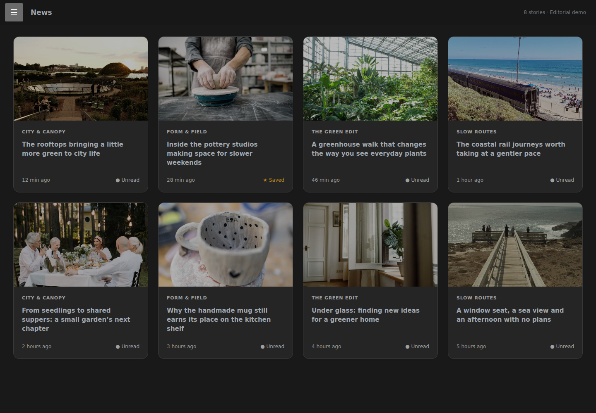
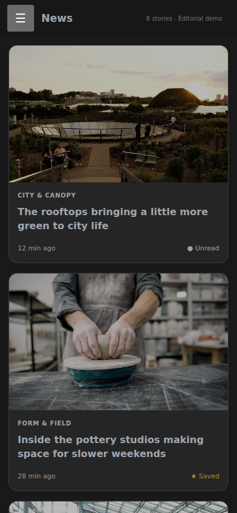
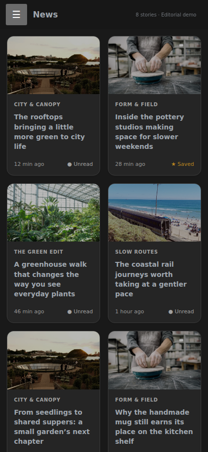
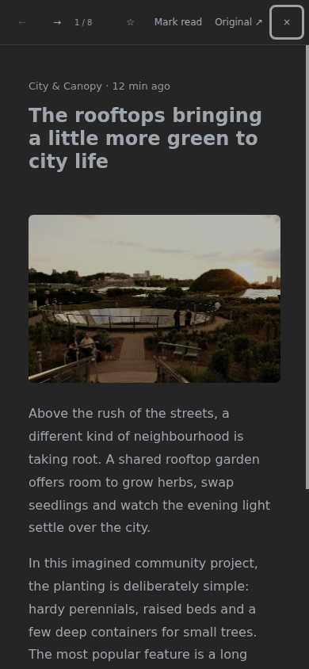

# Inoreader Grid for FreshRSS

A standalone FreshRSS extension that turns **Normal view** into an image-card grid with a focused article reader. Inspired by Inoreader, built with vanilla JavaScript and CSS, and tested against **FreshRSS 1.30.1**.



## Features

- Responsive cards: four columns on desktop, three or two at intermediate widths, and one on smaller phones.
- Full headlines, feed names, dates, unread indicators and saved-article status.
- A centred desktop reader and full-screen mobile reader using the original FreshRSS article DOM.
- Native read/unread and bookmark actions, original-article links, and previous/next navigation.
- Left/Right arrow navigation, Escape to close, and a rightward swipe from the mobile reader's left edge to return to the cards.
- Grid scroll and keyboard focus restored when the reader closes.
- A collapsed feed sidebar with an explicit close button; the native bottom arrow bar stays hidden.
- Neutral charcoal styling, muted text and dimmed images for dark themes.
- Higher-resolution versions selected from existing thumbnails, image enclosures, responsive/lazy image attributes and picture sources. Smaller versions remain available as loading fallbacks.
- Neutral monogram artwork for image-less articles.
- Native pagination and dynamically loaded articles, without a framework or build step.

  

Mobile card lists at two widths, followed by the article reader. Screenshots use fictional articles and eight illustrative stock photos. See [photo credits and demo details](docs/demo/README.md). No personal feeds or account data are shown.

## Requirements

- FreshRSS **1.30.1**. Other versions may work but have not been verified.
- A current browser with JavaScript, CSS Grid and native HTML dialog support.
- Access to the FreshRSS extensions directory. No additional production packages or external services are required.

## Installation

Place the repository contents in a directory named **`InoreaderGrid`** inside your FreshRSS `extensions` directory. For example, from that directory:

```sh
git clone https://github.com/rocket6317/freshrss-inoreader-grid.git InoreaderGrid
```

The resulting layout must include:

```text
extensions/
└── InoreaderGrid/
    ├── extension.php
    ├── metadata.json
    └── static/
        ├── grid.css
        └── grid.js
```

For Docker, install it in the **host directory mounted to the container's extensions directory**. The existing bind mount makes the extension available without restarting the container. Ensure the web server can read its files.

Then:

1. Sign in to FreshRSS and open **Settings → Extensions**.
2. Enable **Inoreader Grid** for your account.
3. Return to **Normal view** and choose any category, feed or search.
4. Refresh the page. Reload an already-open mobile PWA too.

Reader and Global view keep their native presentation. There is no hardcoded account, category or feed selection.

## Reading and navigation

Click a card to open the reader. Use its toolbar to save an article, mark it read/unread or open the original. Opening an article respects FreshRSS's existing automatic mark-on-open preference.

Use **Left/Right arrows** or the toolbar buttons to navigate loaded articles. **Escape**, **×**, or a desktop backdrop click closes the reader. On mobile, swipe **right from just inside the reader's left edge**. Quick flicks can use a shorter distance than deliberate drags. Vertical or diagonal scrolling, tiny gestures, multiple fingers, text selection and gestures on interactive controls do not dismiss it.

The sidebar starts collapsed each page. Use FreshRSS's navigation button to open it and **Close ×** or Escape to collapse it. Pagination remains native; previous/next navigation is limited to articles currently loaded into the page.

While the grid is active, automatic **mark read on scroll** and **remove read articles** are disabled in the page's JavaScript context. This avoids marking unopened cards read and preserves your return position. Saved FreshRSS preferences are not changed. Explicit read actions and native counters remain available.

## Images and appearance

Dark themes use neutral grey accents and softened text. Article images are displayed at **72% brightness and 85% saturation** in dark mode; their original files are not modified. Card headlines are smaller than reader headlines and wrap fully.

The image selector compares supplied variants of the same photo, rather than replacing it with an unrelated larger image. It understands responsive width/density descriptors and selected publisher CDN asset patterns. It never invents a larger URL or scrapes extra article pages. Publisher originals can use more bandwidth than thumbnails.

Appearance is controlled in `static/grid.css`, including the `--ig-*` custom properties. These styles apply only after successful enhancement of Normal view. On an unsupported browser, FreshRSS keeps its original presentation.

## Extension compatibility

The reader moves the **original** `.flux_content` node inside a native dialog within its original `.flux` and `#stream` ancestors, then restores it on close. This preserves article identity and existing delegated controls instead of cloning the content or maintaining a second read/bookmark state.

The implementation uses FreshRSS's `entry_before_display` hook, native article-opening and state functions, load-more events, and DOM observation. AI Summary button state and Readability-provided content are retained by this approach. A live provider call has not been verified; compatibility with extensions that replace native markup or handlers needs individual testing.

## Privacy

- No analytics, telemetry, external scripts, remote fonts or new third-party image service.
- No credentials, account configuration or feed database are required by this extension.
- Display metadata is generated in memory; articles are not rewritten in the database.
- Cards use existing image URLs and send no page referrer. Those image hosts can still receive ordinary browser requests.
- Read/bookmark operations continue through the current FreshRSS installation and its native CSRF handling.
- AI summaries are never triggered automatically. An existing summary extension can still contact its configured provider when you explicitly use it.
- This repository contains extension source, fictional test/demo articles and credited stock photos. Local backups, user CSS/JS, account data, logs and credentials are excluded.

## Disable or uninstall

Disable **Inoreader Grid** under **Settings → Extensions**, then refresh open tabs/PWAs to restore the previous appearance. To uninstall, disable it first and remove only its `InoreaderGrid` directory. No database migration or restoration is needed.

## Development and tests

Production code has no dependencies. The optional browser integration test uses Docker, Chromium, Python 3 and `websocket-client`.

```sh
node --check static/grid.js
php -l extension.php
python3 -m json.tool metadata.json
```

When installed in a FreshRSS container named `freshrss`, run the PHP integration test with:

```sh
docker exec freshrss php extensions/InoreaderGrid/tests/extension.php
```

The test uses FreshRSS's real classes with synthetic entries and default configuration in memory. For another installation layout, set `FRESHRSS_ROOT` to the FreshRSS application root inside the test environment.

For browser tests, create a Python virtual environment and install the test dependency:

```sh
python3 -m venv .venv
.venv/bin/pip install -r tests/requirements.txt
.venv/bin/python tests/browser.py
```

Set `FRESHRSS_CONTAINER` or `CHROMIUM_BINARY` if your container/executable has a different name. The browser test reads the container's native JavaScript and theme files; it does **not** read user configuration, custom CSS or actual feed contents. A localhost fixture serves synthetic articles, state responses are mocked, and synthetic publisher image requests are fulfilled locally.

Coverage includes read/bookmark request handling, dynamic articles, modal DOM identity, scroll/focus restoration, sidebar controls, touch gestures, mobile layout, image resolution and error fallback. Pass `--screenshots` to regenerate screenshots from the separate [editorial demo](docs/demo/README.md) after the tests pass.

## Known limits

- Physical iPhone Safari and home-screen PWA behaviour still needs device verification. Chromium touch emulation cannot verify iOS safe areas or system gestures.
- Authenticated state persistence, real pagination responses and live AI-provider calls are not part of the synthetic integration tests.
- Native dialogs supply focus handling, but a full assistive-technology review has not been performed.
- Revalidate after upgrading FreshRSS: this extension relies on the inspected 1.30.1 DOM and JavaScript functions.

## Licence

Extension code and original demo text: [MIT](LICENSE). Bundled stock photos and photographic material in screenshots retain the [Pexels licence](https://www.pexels.com/license/); see [photo credits](docs/demo/README.md). This is an independent community extension, unaffiliated with Inoreader or FreshRSS.
